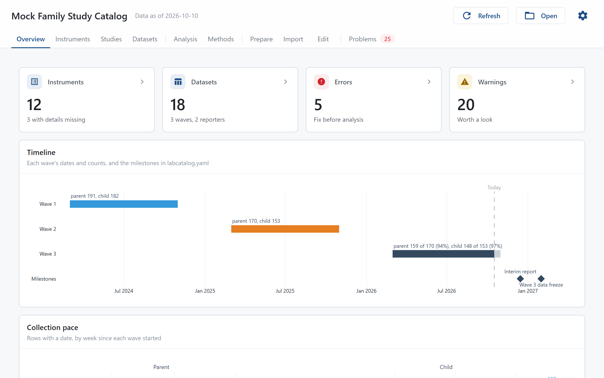
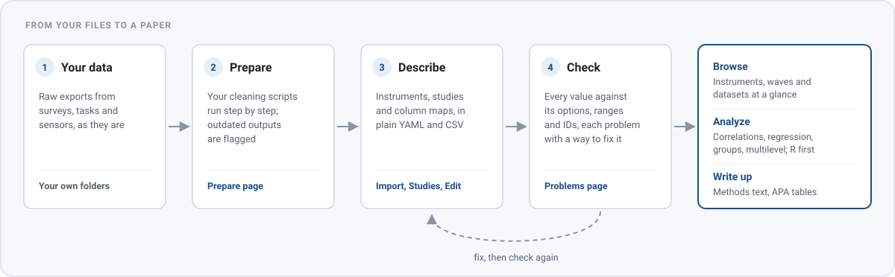
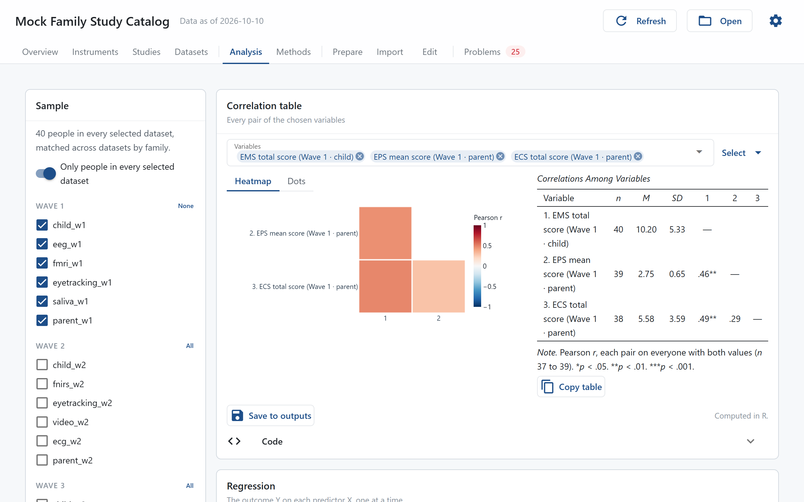
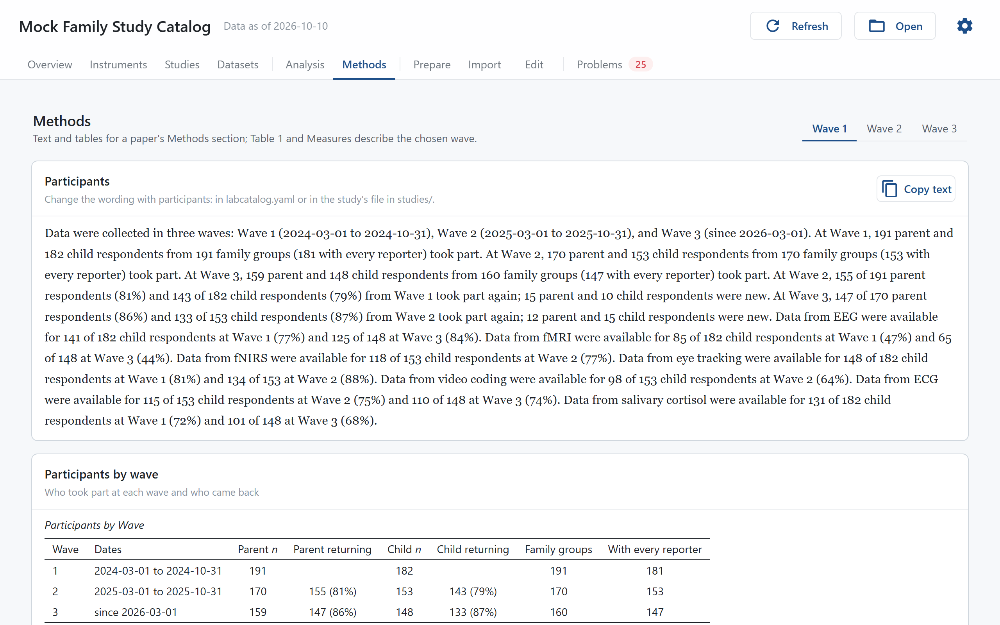
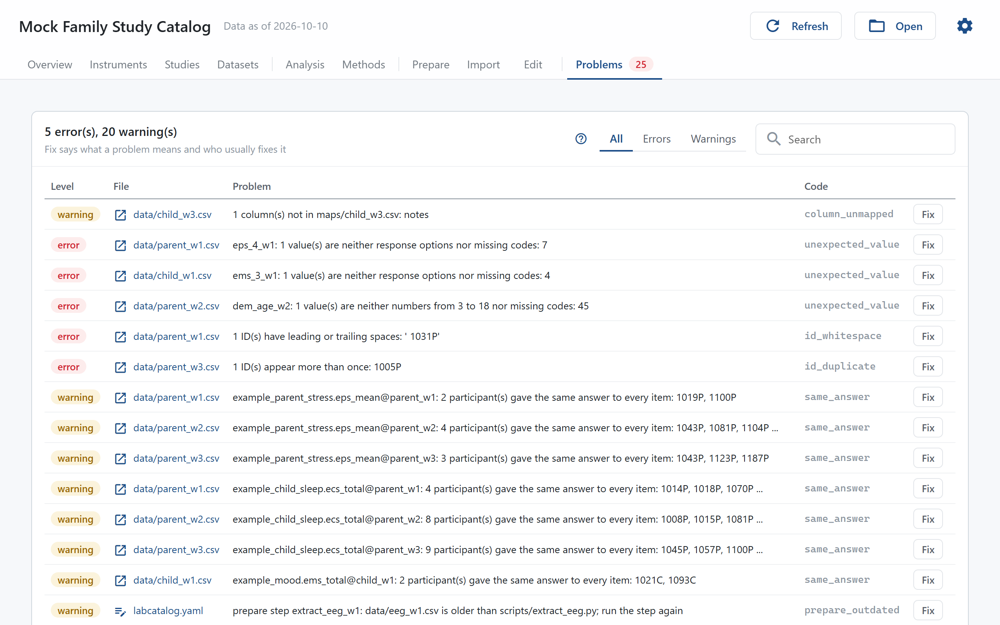

# labcatalog

labcatalog builds a browsable catalog of a lab's study data. You describe your instruments, studies and data files once, and it gives you a desktop window where you can browse every instrument and variable across waves, see where the data disagree with the metadata, run the analyses most papers need, and copy the results as tables and text into a manuscript.

It works with questionnaires and with features from other modalities (EEG, fMRI, eye tracking, physiological measures and others), and it does not assume any particular lab, study design or discipline.



## How it works



Each step has its own page in the window, so the whole loop runs without a terminal. The files stay plain YAML and CSV in your project folder, readable and versioned like any other code.

## A look around

<table>
  <tr>
    <td width="50%"><br><b>Instruments</b>: items, options and scores of each instrument, with reliability, item analysis and factor structure in every wave.</td>
    <td width="50%"><br><b>Analysis</b>: correlations, regressions, group comparisons and multilevel models on the sample you pick, in R or Python, with the code to rerun them.</td>
  </tr>
  <tr>
    <td width="50%"><br><b>Methods</b>: the Participants and Measures paragraphs and APA tables for a wave, ready to paste.</td>
    <td width="50%"><br><b>Problems</b>: every place the data and the metadata disagree, each with a plain explanation and a way to fix it.</td>
  </tr>
</table>

## Install

labcatalog needs Python 3.11 or newer. Install it with [uv](https://docs.astral.sh/uv/):

```bash
uv tool install "git+https://github.com/AU-CONNECT-Lab/labcatalog"
```

or with `pip install "git+https://github.com/AU-CONNECT-Lab/labcatalog"` in an environment of your choice. Then start it with `labcatalog gui`. The first time, it opens a fictional example project to look around in; **Open** in the header opens your own project folder.

## Documentation

The handbook, with a tour of the example, a page for each part of the window and how-to guides, is at <https://au-connect-lab.github.io/labcatalog/>. It is built from [docs/](docs/) with Jupyter Book: `pip install -e ".[docs]"`, then `jupyter-book start` in `docs/`.

## License

Apache-2.0. See [LICENSE](LICENSE).
