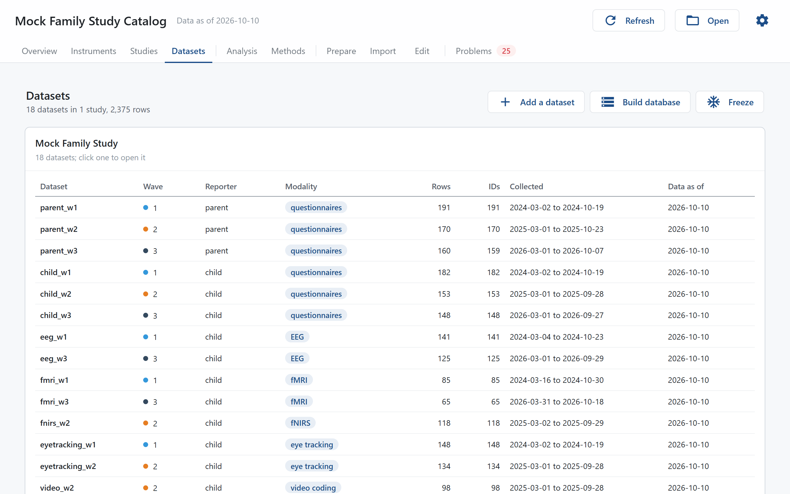
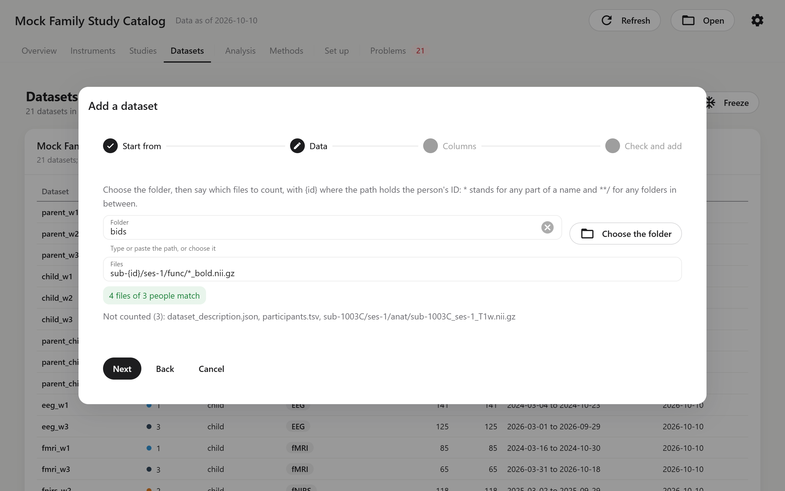

# Datasets

The Datasets page shows each study and its data files: who is in each file, how complete their answers are, which values are missing and why, and the freezes made of the data.

## Studies

The datasets are grouped by study, under the study's label; its description and citation are on the [Studies](studies.md) page. Each study's table lists its datasets:

| Column | Meaning |
|---|---|
| Dataset, Wave, Reporter, Modality | From the dataset's entry in `labcatalog.yaml`. |
| Rows | Rows in the file. |
| IDs | Distinct participant IDs. |
| Collected | The first and last date in the `date_column`. |
| Data as of | The dataset's `snapshot_date`. |

Click a row to open the dataset.

## Add a dataset

**Add a dataset**, above the tables, adds one CSV file to the project. It takes four steps:

1. **Start from**: choose **Repeat a dataset** or **A new kind of file**.
    - **Repeat a dataset** is for a file like one the project already has, usually the same questionnaire in the next wave. Pick it under **Same as**. The new one takes that dataset's modality, study, reporter, ID, group and date columns. The window suggests the next wave and a name with the wave number changed (`parent_w1` becomes `parent_w2`). A folder of files takes the same folder and its files rule with the wave number changed (`ses-1` becomes `ses-2`); check the match on the next step.
    - **A new kind of file** is for the first dataset of a study, or a reporter or modality the project has not had before. Choose **A table** or **A folder of files** (such as scans or recordings), its **Study**, **Modality** and **Reporter**, and type its **Name** and **Wave**.

    Change the suggestions if needed, and set **Data as of**.
2. **Data**: for a table, **Choose the file** as it came from the survey platform or the lab's pipeline. labcatalog copies it into the project and leaves the original where it is. A new kind of file is copied to `data/<name>.csv` as it is. When repeating a dataset that is made by a prepare step, the copy goes where that step would read it, a new step with the new name is added, and it runs right away. If the step stops with an error, the window shows its log.

    For a folder of files, type the **Folder** or press **Choose the folder**, then say under **Files** which files to count, with `{id}` where the path holds the person's ID, such as `sub-{id}/ses-1/func/*_bold.nii.gz` (`*` stands for any part of a name, `**/` for any folders in between). As you type, the window shows how many files of how many people match and lists the first files it does not count. The folder is not copied: the dataset reads it where it is. Each person's row counts their files, so a folder dataset has no columns to match and goes straight to the last step.
3. **Columns**: for a new kind of file, first pick the **ID column**, and the **Date column** if the file has one. Below, each column of the new file is shown next to the instrument and item it belongs to, filled in where a column has the same name as in an existing column map, or as an item's ID, or starts with an item's ID (`eps_10_w2`). The labels above the table say how many items of each instrument were found. Fill in **Instrument** and **Item** for any column the window missed, and leave the ID, dates and other columns empty. Columns of an instrument the catalog does not have yet come in later through the [Import](import.md) page.
4. **Check and add**: the lines that will be added to `labcatalog.yaml` (the dataset, the new wave and the new prepare step if any), the new column map in `maps/`, and the study file, where the dataset is added to each instrument's administration. **Add the dataset** writes them all and opens the new dataset.

**Cancel**, or closing the window, removes the copied file. A wave the study does not have yet is added to it without dates; fill in its start and end dates on the [Studies](studies.md) page afterwards. Before it writes anything, the window checks the project with the changes in place and stops if they would cause a new error. Folder datasets can be repeated, and so can datasets that are one CSV file, made by no prepare step or by one that reads a single file named after the dataset. For a file that needs a cleaning step of its own, see [Add a Wave or Dataset](../how-to/add-dataset.md).

## A dataset

The top of a dataset's page lists its study, wave, reporter and modality; its rows and IDs; with a group, the number of groups; how many people were also in the previous wave and how many are new; when it was collected; and the data file, which opens in its own application when clicked. **All datasets** goes back to the list.

Below that:

- **Methods**: how this modality's data were collected and processed, from `methods` in the study file.
- **Instruments**: each instrument in the file, with how many people answered all, some or none of its items. Open answers do not count. Click a row to open the instrument.
- **Missing values**: how many cells are blank, how many hold each missing code, and how many hold a value that is neither an answer nor a missing code.
- **Collected by month**: rows per month, when the dataset has a `date_column`.
- **Problems**: the problems found in this file and its column map. The file links open the Edit page at the line.
- **Label code**: R code (with haven) and Python code (for pyreadstat) that puts the item wording, response labels and missing codes on the data, for example to save it as an SPSS file.

## Freezes

A freeze records every data file the catalog reads, with its checksum, rows and participants, so you can say later which data a result used. Press **Freeze**, give the freeze a name such as `2026-06-submission`, and press **Freeze** in the dialog. The record goes to `freezes/`. If the data are in DataLad, the freeze also saves each dataset and tags it with the name, so that version can be opened again later; otherwise the record shows whether the data changed, but cannot bring back data that were overwritten.

The **Freezes** table lists every freeze, newest first. A freeze with a DataLad tag has an **Open** button, which opens a copy of the project as it was at that freeze. The header then says which freeze is shown and whether the data match its record, and **Back to the project** returns to the current project. See [Using labcatalog with DataLad](../how-to/datalad.md).

## Get missing content

When a project is a DataLad clone whose files have not been downloaded yet, it cannot load, and the page shows **Get missing content**. It downloads the metadata and then the data files the project reads, and reloads the project. It needs the path to `datalad` on the Settings page.
