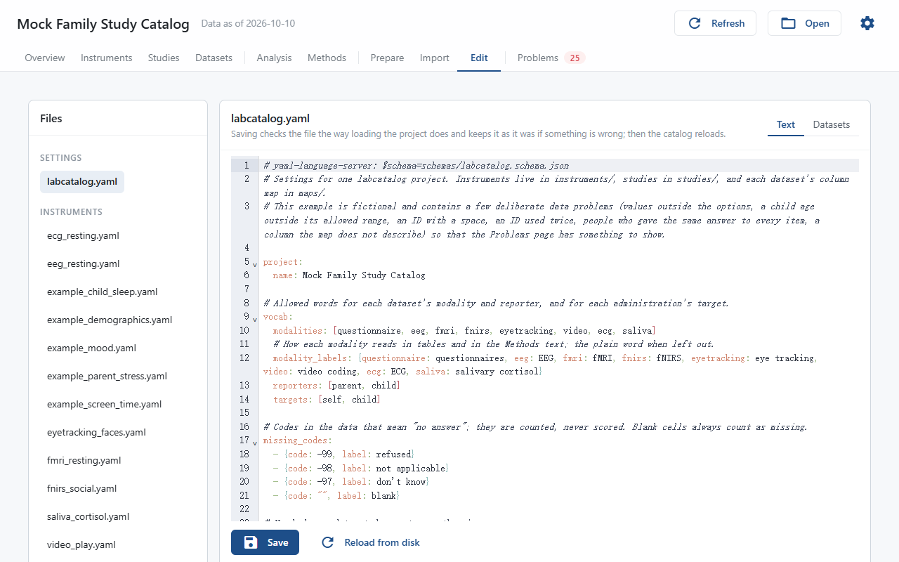

# The Editor

The editor, below **From a codebook** in the [Codebook](codebook.md) step of the Set up page, edits the project's files: `labcatalog.yaml`, the instrument files, the drafts, the study files and the column maps. The files are listed on the left; click one to open it.

## Form

Every YAML file opens as a form: boxes to type in, lists to pick from and tick boxes, so nobody needs to know YAML. An instrument file shows **About** (name, abbreviation, kind, construct, description, instructions, default response set, license), **Response sets**, **Items**, **Scores**, **References** and, when the project declares instrument fields, **Custom fields**. A study file shows its **Administrations** and their **Overrides**; `labcatalog.yaml` shows its **Datasets**, each with the lab's own dataset fields on its line, and its **Fields**: the lab's own fields (`custom_fields`), each with a name, a label, what it applies to (datasets, instruments, scores, items, administrations or studies), a type (choice, tags, text, number or date) and, for choice and tags, its choices. **Add field** adds one. Renaming a field, or deleting it, is shown before saving with how many values it has in the project's files; **Change and save** renames or removes those values in every file, and in the Instruments page's filters, as it saves. The lists offer what the project already has: the response sets and items of the instrument, the instruments and datasets of the project, the studies, waves, reporters and modalities of `labcatalog.yaml`, and the keys in `references.bib`. An override offers the items, response sets and datasets of the administration it belongs to. Typing a value that is not offered is still allowed. Renaming a response set takes effect when you leave its box, and the items and the default response set that use it are renamed with it; a name another response set already has is refused.

Each entry is one line; the button with the sliders opens its other fields, the arrows move it and the bin deletes it. **Add item**, **Add score** and the like add an entry at the end, numbered after the last one (`ems_10` after `ems_9`) and with the same response set as the entry above it. **Save** checks the file as below and lists any problem under the buttons; **Discard changes** goes back to the file as saved. A part of the file the form cannot show, such as item text written per language, says so and is left as it is.

An instrument file has its **Structure** above the editor, the same tree as on the instrument's page. It follows your changes within a second, in the form, the text and the tables alike; while the file cannot be read, it keeps the last version it could draw and says why. Click its title to fold it away.

## Advanced: text and tables

**Advanced** opens the file as text or as tables, and **Form** goes back. Column maps have no form and open as a table, one row per column of the data file, with **Instrument** chosen from the project's instruments; **Text** shows the CSV itself.

### Text mode

Every file can be edited as text. **Save** checks the file the same way loading the project does. If something is wrong, nothing is written, and each problem is listed under the editor with its line, which is also marked in the text. When the file is right, it is saved and the catalog reloads. A tag or a choice that the field's `choices` in `labcatalog.yaml` do not list yet, typed in any of the modes, is shown before saving; **Add and save** adds it to the choices and saves both files. **Reload from disk** throws away your changes.

### Table mode

Some parts of a file can also be edited as a table, chosen with the toggle above the editor:

| File | Tables |
|---|---|
| `labcatalog.yaml` | Datasets |
| Instrument files and drafts | Items, Scores, Response sets, and Custom fields when the project declares instrument fields |
| Study files | Administrations, Overrides |

Every cell can be edited; tick boxes and fixed choices show as such. Write lists with commas, for example `ems_1, ems_2`. **Add row** adds a row, **Delete ticked rows** deletes the rows you ticked, and dragging a row by its handle moves it. Saving changes only the cells you changed, so comments and the rest of the file stay as they were. A value set back to its default is removed from the file.

A file whose YAML cannot be read opens only as text; fix it there first.

## New instruments

- **New instrument** creates `instruments/<id>.yaml` with the required keys.
- **New instrument from a PDF** drafts a whole instrument with the language model set on the Settings page. The draft goes to `drafts/`, outside the catalog. Check it against the PDF, then press **Move to instruments**. See [Add an Instrument](../how-to/add-instrument.md).

## Unsaved changes

Opening another file or switching mode with unsaved changes asks whether to discard them. Pressing **Refresh**, or anything else that reloads the catalog, redraws the page without asking, so save first.
