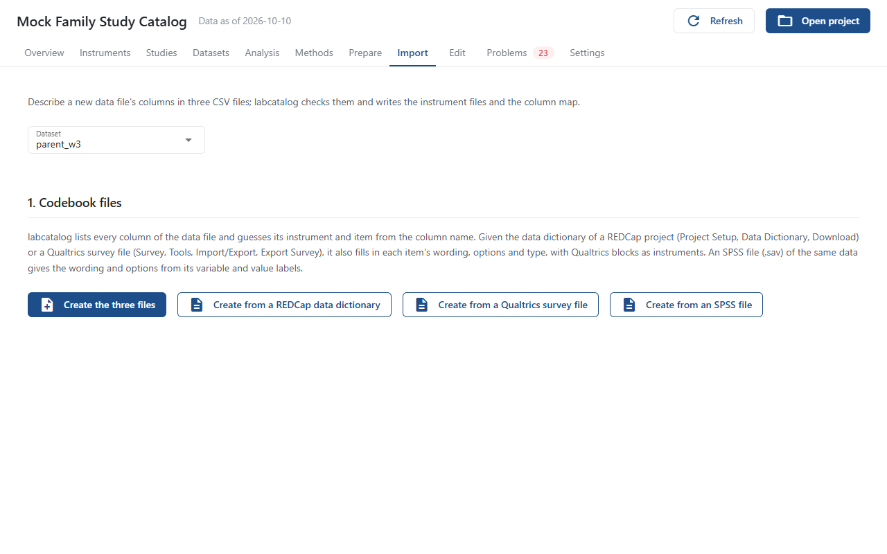

# Files Without a Column Map

**Files without a column map**, in the [Add data](add-data.md) step of the Set up page, creates instrument files and a column map for a data file listed in `labcatalog.yaml` that has no column map yet; a file added with **Add a data file** gets its map there and then. To describe instruments before there is any data, use the [Codebook](codebook.md) step. [Add an Instrument](../how-to/add-instrument.md) walks through it. When every dataset has a map, only **From a pipeline's table** shows.

Pick the **Dataset**, then:

## 1. Codebook files

Create the three files in `codebook/<dataset>/`: `items.csv`, `instruments.csv` and `scores.csv`.

- **Create the three files** lists every column of the data file and guesses its instrument and item from the column name.
- **Create from a REDCap data dictionary**, **Create from a Qualtrics survey file** and **Create from an SPSS file** also fill in each item's wording, options and type. Qualtrics blocks become instruments.

The REDCap data dictionary or Qualtrics survey file is also kept as the dataset's codebook, in `codebook/<dataset>/source/`; an SPSS file is not, since it holds the data. **Keep the codebook** (or **Codebook**, once one is kept) beside the heading keeps any other file, such as a PDF, there too, and opens the ones kept, here and on the dataset's page.

Once the files exist, the page links to them and **Open folder** opens their folder. **What goes in each column** explains every column of every file.

## 2. Fill them in with an AI (optional)

**Copy AI prompt** copies a prompt with the format, the data file's column names (no data) and the instruments already in the project. Paste it into a chat model together with your codebook, paste the answer into **The AI's answer**, and press **Replace the three files with this answer**.

## 3. Import

**Check and import** checks the three files and lists every problem by file and line. When there are none, it writes the instrument files and `maps/<dataset>.csv`, and shows the lines to add to the study file, since labcatalog does not change study files itself. Instruments already in the project are only mapped.

## From a pipeline's table

Below the codebook steps, and also when every dataset already has a column map, **From a pipeline's table** brings in a pipeline's table of measures; see [Bring In a Pipeline's Tables](../how-to/pipeline-tables.md). **Choose table** picks the `.tsv`; give the **Name** that starts the new instruments' and datasets' IDs, and the **Study**, **Modality** and **Reporter** of the datasets. **Split by**, **Columns**, **Wave** and **Instrument name** are optional; several values are separated by spaces or commas. **Write the files** writes them and shows the lines to add to `labcatalog.yaml` and the study file. When the pipeline writes the table again, choose it here again: the data files are rewritten and changes to the instruments stay.
