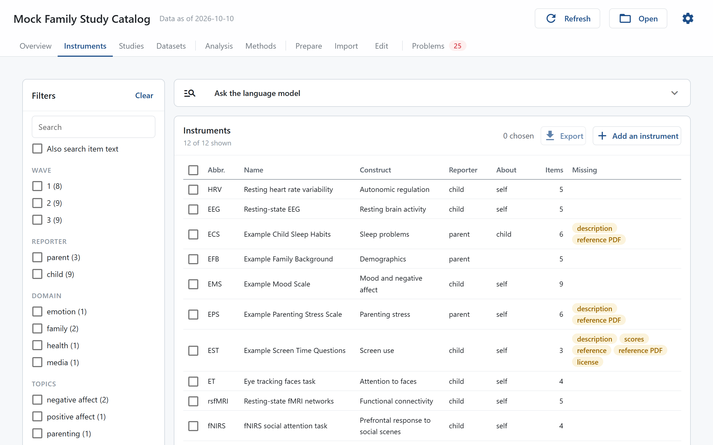
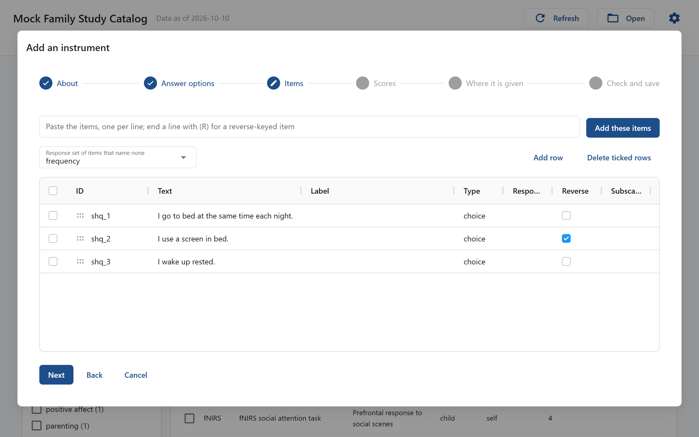
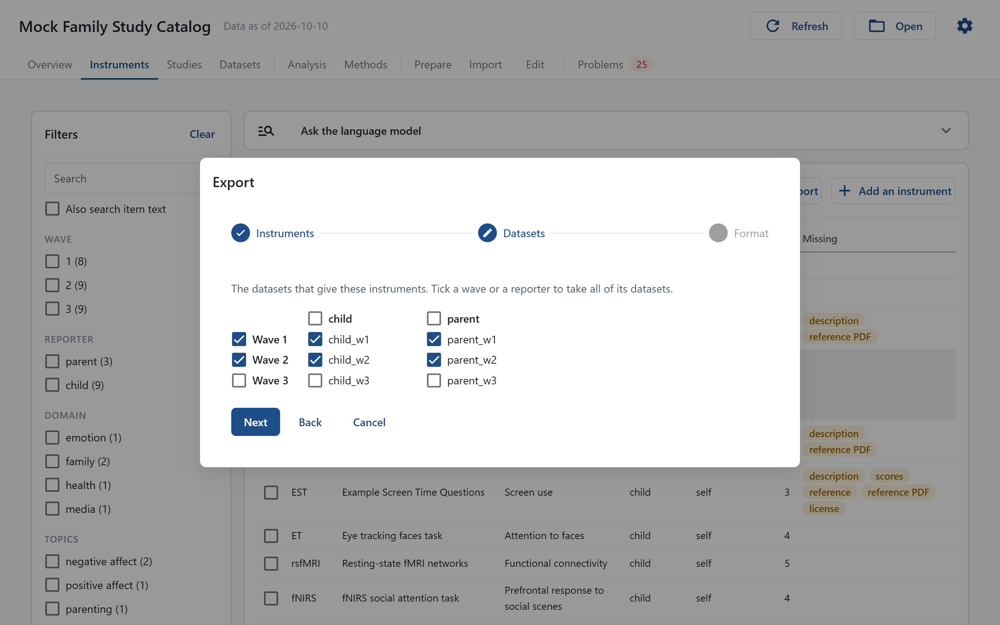
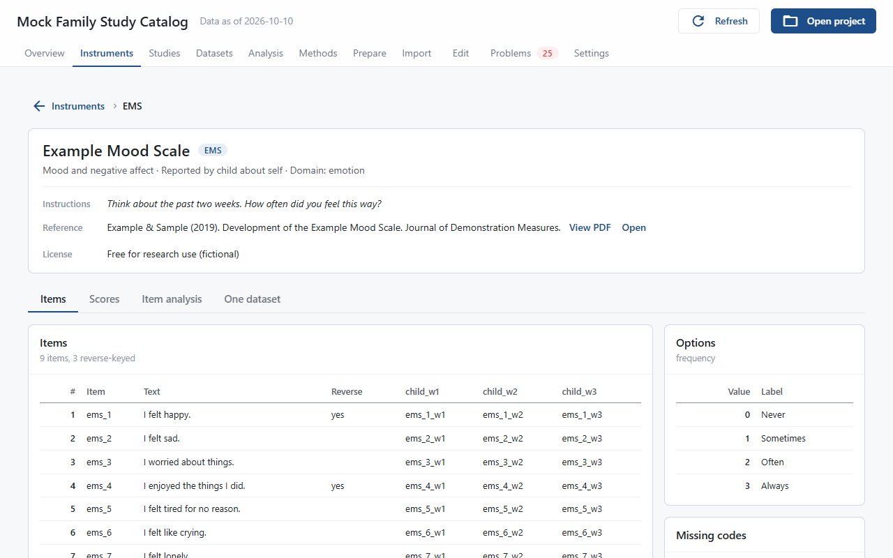

# Instruments

The Instruments page lists every instrument. Click one to open its page: items and options, scores and their reliability, how they change across waves, factor structure, and code to score them.

## The list

On the left:

- **Search** finds instruments by ID, name, abbreviation, construct, custom field or the name of a data column mapped to them. Tick **Also search item text** to search the wording of the items too.
- The filters narrow the list by study, wave, reporter, who the instrument is about, modality and the `choice` and `tags` custom fields, or by the list set in `browse.facets`. **Given in** finds instruments given in every wave of their study, or in fewer. **Catalog** finds instruments that are complete or still lack something, such as scores or a license, and those not yet in any dataset. A filter with only one value is hidden. Values within one filter combine with "or", different filters with "and". The number beside each value is how many instruments it would show. The chosen values appear above the table, where × removes one; **Clear** clears them all.

The table shows each instrument's abbreviation, name, construct, reporters, number of items, and how many people answered it in each dataset the filters show. The **Missing** column lists what the catalog still lacks for an instrument, such as its scores, reference or license.

**Map** beside **List** draws the instruments the filters show as one graph, colored by modality: each instrument holds its scores, each score its items, and a line joins scores of different instruments that correlate at |*r*| ≥ .30 in some wave. Hover over a dot to see its links and name, scroll to zoom, and click a dot to open its instrument, at the **Scores** tab for a score or the **Items** tab for an item.

### Ask the language model

With a language model set up (see [Set Up R and Language Models](../how-to/r-and-models.md)), **Ask the language model** finds instruments from a description in your own words, such as "trouble falling asleep". It sends the instruments' names and item wording, never any data. The answer lists the matching instruments and items with the model's reasons, and narrows the list until you press **Clear**.

### Add an instrument

**Add an instrument** walks through a new instrument in six steps: what it is (ID, name, abbreviation, kind, construct, description, references from `references.bib` with the PDF of each, license); its answer options, copied from an instrument with the same answers or typed in; its items, pasted one per line, with `(R)` at the end of a reverse-keyed item; its scores, starting from **Add a total score**; the datasets it was given in, where **Find the columns** guesses each item's column from the column names; and a last step that shows the lines each file gains before **Save**. It writes `instruments/<id>.yaml`, the rows of each dataset's column map and the administrations in the study files.

On an instrument's page, **Complete this instrument** beside what is missing opens the same steps on that instrument, starting at the first step with something missing. Press a step's title to go straight to it; only **Check and save** is reached with **Next**. Lines of the file that are not changed stay as they were, comments included.

### Export

Tick instruments in the table and press **Export** to write their variables, data and statistics to `outputs/`. The dialog asks for the instruments, then the datasets by wave and reporter, then the layout. See [Export Variables and Data](../how-to/export-data.md).

## An instrument's page

The top shows the instrument's name, abbreviation, construct, who reported on whom, its instructions, references with their PDF (**View PDF** shows it in the page, **Open** in your PDF viewer), its license, and what is missing from the catalog. **Instruments** at the top goes back to the list.

### Items

**Structure** draws the instrument as a tree: its scores, each with its items, and the items no score uses. A score made of every item of the other scores, such as a total, is one leaf, so its items are not drawn twice; **Answer options** opens with a click. Hover over a node for an item's wording and type or a score's items and missing-answer rule.

Below it, the items with their wording, whether they are reversed, and the column that holds each one in every dataset. Beside them, the response options and the missing codes.

### Scores

A table of every score in every wave: *N*, mean, *SD*, median, observed and possible range, Cronbach's α, McDonald's ω (once the factor models are done) and how many people answered every item. Below it:

- Box plots of the scores in each wave, and the distribution of the total score.
- **Scores across waves**: the mean of each score in each wave, for everyone and for the people who took part in every wave.
- **Stability across waves**: the correlation of the same people's scores one wave apart.
- **Invariance across waves**: whether the score measures the same thing in each wave (configural, metric and scalar invariance). It needs R.
- **Invariance across reporters**: the same test between reporters who answered the instrument in the same wave, such as a parent and a child rating the child's mood. The reporters of one group are paired through `stats.correlate_by`, so this section appears only when that names a group.
- **Against other scores**: how this score correlates with every other score measured in the same wave.

Under each invariance table, a **Results paragraph** gives every step's fit and its change from the step before (Δχ², ΔCFI, ΔRMSEA), with a **Copy text** button; it reports the numbers and leaves the judgement of which step holds to you. **Which items differ** runs a score test for each item at the step you choose: how much the fit would improve if that item's loadings, thresholds or intercepts were free to differ. Tick the items to free and press **Save and rerun**; labcatalog writes them under `stats.invariance_free` in `labcatalog.yaml` and tests again with those items freed (partial invariance). The table note lists what is freed. To hold an item equal again, untick it in the same dialog. **Save to outputs** under an invariance table also writes Mplus inputs with their data: across waves and reporters, one input per step (configural, metric, scalar) with the freed items, chained with `DIFFTEST` for ordered items, to be run in that order; across groups, one input that uses Mplus's own `MODEL = CONFIGURAL METRIC SCALAR`, which does not apply freed items. These follow Mplus's usual steps, so there is no step for thresholds alone, and with ordered items Mplus's metric step frees the thresholds, so its numbers differ from the metric row of the table; the configural and scalar steps are the same models. With the path to Mplus set on the Settings page, **Run in Mplus** runs them.

### Item analysis

How the items were answered: the share of each option per item and wave, item means as radar charts, each wave against the others, item-total correlations with α without each item, and the correlations between items. For a demographics instrument, a table of the sample in each wave.

### One dataset

Pick a dataset to see the instrument in that file alone:

- **Items in** the dataset: valid answers, missing codes and values that are not options, per item.
- **Factor structure**: a confirmatory factor analysis of the scores' items, with fit indices (RMSEA with its 90% CI when fitted in R), standardized loadings and ω. The switch in the panel's title bar chooses how the items are treated: WLSMV (ordered categories), ML or MLR (continuous; MLR gives robust fit indices). It starts at the project's `stats.cfa_estimator` and changes only what you see now; the table notes and saved outputs say which was used. Without R, the models are fitted in Python with maximum likelihood whatever is chosen. An instrument with three or more subscales gets two more models of a general factor over them: a second-order model (items on subscale factors, subscale factors on the general factor, as in JASP), with hierarchical ω (computed in R only), and a one-factor model of the subscale scores, which treats the scores as continuous. With exactly three subscales the second-order model fits the same as the subscale model and the subscale-scores model fits exactly, so only their loadings and ω say something new. **Save to outputs** under these tables also writes each model as an Mplus input (`.inp`) with its data (`.dat`), with the estimator chosen in the switch; with the path to Mplus set on the Settings page, **Run in Mplus** runs them and leaves the results in `.out` files beside them. A **Results paragraph** below the tables reports each model's fit indices, the range of its standardized loadings and ω, without judging the fit.
- **Measures paragraph**: a draft paragraph for the paper, with α and ω in this dataset, and a **Copy text** button. With a language model and the reference PDF, **Draft the description from the reference PDF** drafts the instrument's `description` for you to check.
- **Everyone's answers**, **Answers by participant** and **Standardized scores**: each person's answers and scores, to spot unusual response patterns.
- **Scoring code**: R and Python code that computes the scores from this data file.
- **Scoring step**: for an instrument with a score computed by a script (`method: script`), the script that computes it in this dataset. **Start an R script** or **Start a Python script** writes a template in `scripts/` that reads the data file and writes the ID and each score's column, for you to fill in; **Use my own script** takes a script of yours that does the same. Either becomes a [prepare step](prepare.md), run in the Add data step of the Set up page, that writes `data/<dataset>_<instrument>_scores.csv`, and the dataset's `scores` in `labcatalog.yaml` names that file. Once there is a step, the panel shows its command and opens the script.
- **Scoring script from the reference PDF**: with a language model, **Write with the language model** writes an R and a Python scoring script from the instrument's manual, saved in `scoring/`. They read the data file and write the scores file like a scoring step's script, and **Use ... as the scoring step** makes one of them the step: its scores with `method: script` are then read from it, and its columns for summed or averaged scores are checked against labcatalog's own, each row that differs reported in Problems.

### History

If the project is in git, every commit that changed the instrument's file, with what changed.
