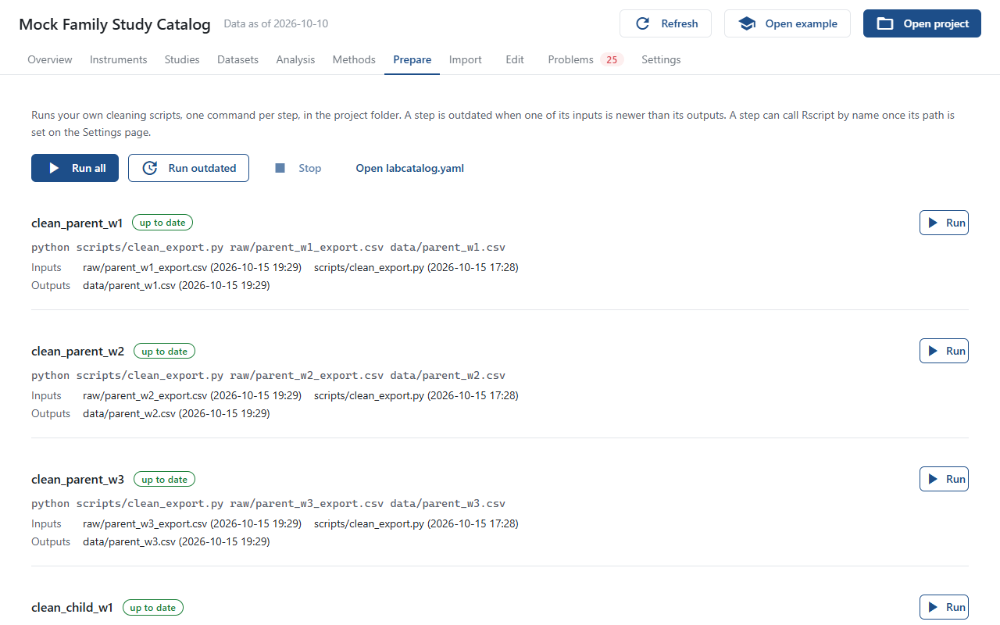

# Prepare Data

**Prepare data**, the first step of the Set up page, runs the prepare steps in `labcatalog.yaml`, the scripts that turn raw exports and pipeline outputs into the data the catalog reads. See [Register Prepare Steps](../how-to/prepare-steps.md) for how to write them. A project with no steps yet shows an example to copy.

## The steps

Each step shows its name, its status, its command, and its inputs and outputs with their dates. Click a file to open it. The status is one of:

| Status | Meaning |
|---|---|
| up to date | Every output is newer than every input. |
| outdated | An input is newer than an output. |
| missing output | An output does not exist yet. |
| missing input | An input does not exist or has not been downloaded. |

A file in a DataLad dataset whose content is not on this computer is marked "not downloaded" and has a **Get** button.

## Running

- **Run** runs one step.
- **Run all** runs every step in order, after asking.
- **Run outdated** runs, in order, the steps that are not up to date. Each step is checked just before its turn, so a step whose inputs were just rebuilt runs too.
- **Stop** ends the running step and anything it started.

A step that fails stops the rest. After a step has run, its status line shows the outcome and **Log** shows what it printed; the log follows the running step live and has a **Copy log** button. When a step succeeds, the catalog reloads.

Steps run in the project folder. If Rscript is set on the Settings page, its folder is put first on the PATH, so a step can call `Rscript` by name. So is the Python set there, so a step that calls `python` gets it; in the Windows program, with no Python set, `python` runs the program's own. With `prepare_with: datalad`, each step runs through `datalad run`.
