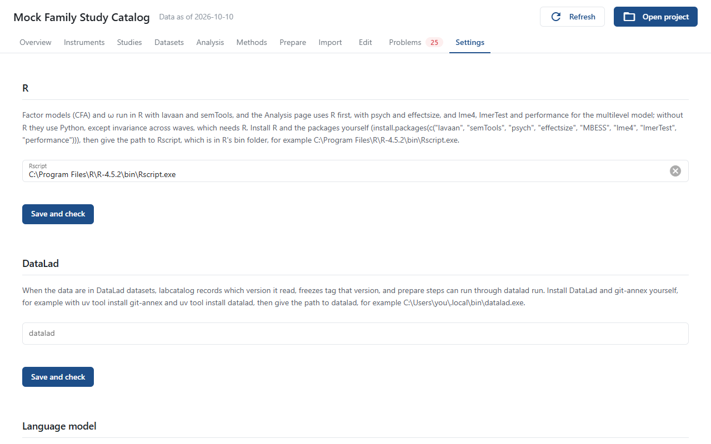

# Settings

The Settings page holds the settings of your computer, not of the project: they apply to every project you open and are not shared with anyone else who opens one. Settings that change the numbers are in `labcatalog.yaml` instead (see [Statistics](../statistics/index.md)).

## R

The path to `Rscript`. **Save and check** runs R once and reports its version and any missing packages, with the command to install them. See [Set Up R and Language Models](../how-to/r-and-models.md).

## DataLad

The path to `datalad`. **Save and check** reports the versions of DataLad and git-annex. See [Using labcatalog with DataLad](../how-to/datalad.md).

## Language model

The **Provider** (Anthropic, OpenAI, Gemini, or a local OpenAI-compatible server), the **Model**, and for a local server its address. A cloud provider's API key is read from an environment variable and never stored; the page says whether it is set. Press **Save**.

## Appearance

**Light** (the default), **Dark**, or **Same as the system**. Charts follow the window's colors. **Chart colors** chooses the color palette of every chart.

## Tables

- **Word or Google Docs** or **LaTeX**: what the copy buttons copy. See [Copy Tables into a Manuscript](../how-to/copy-tables.md).
- **Decimal places in tables**: 1 to 4, 2 by default. *p* values always keep three.

## Where the settings are kept

In a file named `gui.json`: `%APPDATA%\labcatalog` on Windows, `~/Library/Application Support/labcatalog` on macOS, and `~/.config/labcatalog` on Linux.
