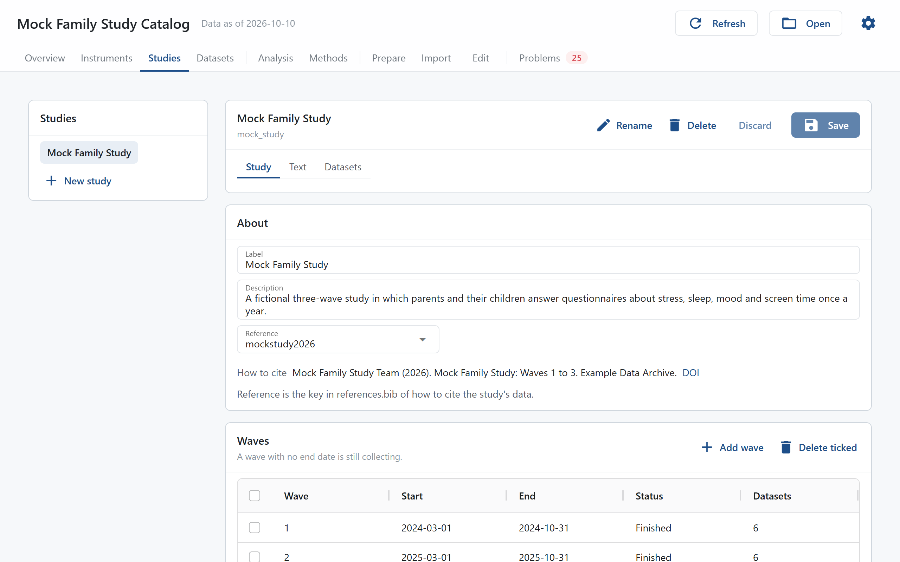

# Studies

The Studies page shows and edits each study: its label, description and reference, its waves and milestones from `studies` in `labcatalog.yaml`, and the methods text and Participants template from its study file. The studies are listed on the left; click one to open it. See [Studies, Waves and Datasets](../concepts/studies-waves-datasets.md).

A study opens with its label and ID on top, the buttons **Rename**, **Delete**, **Discard** and **Save**, and three tabs: Study, Text and Datasets.

## Study

**About**:

- **Label**: how the study reads in the window.
- **Description**: a sentence or two on what the study is.
- **Reference**: the key in `references.bib` of how to cite the study's data, chosen from the keys in the file. The "How to cite" line below it shows the citation.

**Waves**: one row per wave, with its **Start** and **End** dates written as `2026-03-01`. **Status** says whether the wave is planned (it starts after today), collecting (it has started and has no end date, or ends after today) or finished, and **Datasets** how many datasets belong to it. Double-click a cell to edit it. **Add wave** adds a row with the next number, and **Delete ticked** removes the rows you ticked. A wave that still holds datasets cannot be removed: saving stops and lists the datasets that name it.

**Milestones**: dates shown on the [Overview](overview.md) timeline, such as an interim report or a data freeze, each with a **Name** and a **Date**. **Add milestone** and **Delete ticked** work as for waves.

**Collection pace**: for each reporter, how many people had come in by each week since each wave started, one line per wave, so a wave still collecting can be set against the ones before it. Each person counts once in a wave, from the earliest date in any of their files. It needs a `date_column` on the datasets.

## Text

**Methods**: one box per modality the study's datasets use, for how its data were collected and processed, and one for each dataset given its own text in the study file. The text is shown on the [Methods](methods.md) page under Procedure and with each dataset. Leave a blank line between paragraphs. It is written to `methods` in the study file.

**Participants**: the template of the study's Participants paragraph on the Methods page, with placeholders such as `{waves}` and `{counts}`; the page lists them all. Leave it empty to use the project's template. **Preview** writes the paragraph from the current data with the template in the box, before you save it.

## Datasets

The study's datasets, as on the [Datasets](datasets.md) page. Click a row to open the dataset there. **Add a dataset** opens the [Add a dataset](datasets.md#add-a-dataset) window. For a study with no datasets yet the button reads **Add the first dataset**, and the window starts from a new kind of file with the study already chosen.

## Saving

**Save** and **Discard** are on once something has changed on any tab. **Save** checks the whole project with the changes in place and writes nothing if they would cause a new error; the problems are listed under the tabs. Otherwise only the lines you changed are written to `labcatalog.yaml` and the study file, comments stay where they were, and the catalog reloads. **Discard** throws your changes away. Opening another study with unsaved changes asks first.

## New study

**New study** asks for an ID (lower-case letters, digits and underscores, starting with a letter) and a label. It adds the study under `studies` in `labcatalog.yaml` and creates its study file, `studies/<id>.yaml`, with only the `study` key. Fill in its waves, then add its first dataset on the Datasets tab.

## Rename

**Rename** changes the study's ID everywhere it is used: under `studies` in `labcatalog.yaml`, in the `study` of each of its datasets, and in its study file, which is renamed to the new ID when it was named after the old one. Warnings you marked as fine on the [Problems](problems.md) page that name the old ID show again.

## Delete

**Delete** removes the study from `labcatalog.yaml`, together with its datasets, their column maps in `maps/` and its study file. The window lists everything it will remove, and **Delete** works only after you type the study's ID. The data files stay where they are, and so do any prepare steps that make them; remove those in the [Edit files](edit.md) step of the Set up page if they are no longer needed. labcatalog keeps no copy of what it removes, so to undo a deletion, restore the files from git or DataLad.
